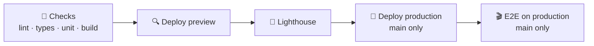

<h1 align="center">web</h1>

<p align="center">
  <strong>A production-shaped starter for React single-page apps.</strong><br />
  Typed end to end, tested at every level, deployed on every push.
</p>

<p align="center">
        
</p>

<p align="center">
  <a href="#-quick-start">Quick start</a> ·
  <a href="#-what-is-inside">What is inside</a> ·
  <a href="#-commands">Commands</a> ·
  <a href="#-project-structure">Structure</a> ·
  <a href="#-cicd">CI/CD</a> ·
  <a href="#-git-workflow">Git workflow</a>
</p>

<hr />

> [!NOTE]
> The stack, layout and rules are in [CLAUDE.md](CLAUDE.md) and
> [apps/web/CLAUDE.md](apps/web/CLAUDE.md).

## 🧰 What is inside

| | Area | What you get |
|:-:|---|---|
| ⚛️ | **App** | React 19, Vite 8, TypeScript 6 (strict), React Router 8 (lazy route objects, a route error boundary), a stale-chunk reload after a deploy. No SSR. |
| 🎨 | **UI** | shadcn/ui on Tailwind CSS 4 (CSS-first theme tokens), shared as the source-only package `@repo/ui`; lucide icons, sonner toasts, a dark theme. |
| 🏠 | **Landing page** | One public marketing page, no API layer. |
| ✅ | **Quality** | Vitest 5 and Testing Library (coverage gate: 80% of lines in `src/features` and `src/lib`), Playwright with axe accessibility checks, Allure 3 reports, Storybook 10, Lighthouse. |
| 🛠️ | **Tooling** | Oxlint (type-aware, plus the vendored anti-slop rules, no ESLint), Prettier, Husky, lint-staged, commitlint, Dependabot. |

## ⚡ Quick start

Needs Node 22.22 or newer and pnpm 11 (the version is pinned in `packageManager`;
`corepack enable` picks it up).

```
pnpm install
pnpm dev
```

## 💻 Commands

Run them from the root; turbo runs each in every package that has the script.

| Command | What it does |
|---|---|
| `pnpm lint` / `pnpm lint:fix` | 🧹 Oxlint (type-aware, `--deny-warnings`) and Prettier, check or fix |
| `pnpm typecheck` | 🔎 Type-check every package |
| `pnpm test` | 🧪 Vitest with coverage; `pnpm test:watch` re-runs the tests a saved file affects |
| `pnpm test:e2e` | 🎬 Playwright on the mocked build; `pnpm test:e2e:install` downloads Chromium once |
| `pnpm build` | 📦 Production build |
| `pnpm --filter web storybook` | 📚 Storybook on port 6006; `pnpm build-storybook` builds it statically |
| `pnpm lighthouse <url>` | 🔦 Lighthouse (mobile) on a deployed or previewed page |
| `pnpm check` | 🛡️ Every gate: the six below |
| `pnpm check:report` | 📋 The same gates, going on after a failure, then a checklist with pass rates and coverage |
| `pnpm test:tools` | 🔧 The tests of the scripts in `tools/` |

One package: `pnpm --filter <name> <script>`.

## ✅ Check

`pnpm check` runs six gates, and you run it before committing:

| # | Gate | Tool |
|:-:|---|---|
| 1 | Lint and format | Oxlint, Prettier |
| 2 | Type-check | `tsc -b` |
| 3 | Unit and component tests | Vitest, Testing Library, MSW |
| 4 | Production build | Vite |
| 5 | Storybook build | Storybook (fails when a story does not compile) |
| 6 | End-to-end tests | Playwright, axe |

`pnpm check:report` runs the same gates and prints a checklist with the unit and e2e pass rates
and coverage (`pnpm test:e2e:install` downloads Chromium once per machine). `pnpm lighthouse <url>`
scores a deployed or previewed page (CI does it on every preview deploy). While coding,
`pnpm test:watch` re-runs the affected tests on every save.

## 📁 Project structure

```
apps/web/                     the app (package `web`): src/app, src/features, src/lib,
                              e2e/ (Playwright), .storybook/, public/_headers (Pages headers)
packages/ui/                  @repo/ui: shadcn components, cn(), Tailwind theme tokens
packages/typescript-config/   shared tsconfig bases
tools/                        check:report and Lighthouse scripts, the vendored anti-slop rules
.github/workflows/            ci.yml: the whole CI/CD pipeline
.husky/                       git hooks
oxlint.config.ts              the one linter's rules
```

Inside the app, code is organized by feature (`src/features/<name>`), each component with its own
tests and stories. Apps depend on packages, never the reverse, and packages are source-only and
consumed through their `exports` (`@repo/ui/components/button`). The full layout, the code style
lint enforces and the testing rules are in [apps/web/CLAUDE.md](apps/web/CLAUDE.md).

## 🚢 CI/CD

`.github/workflows/ci.yml` runs on pull requests and on pushes to `main`:



1. **Checks:** lint, typecheck, unit tests with coverage, the app build, the Storybook build and the
   build that gets deployed.
2. **Deploy: preview:** the app and Storybook go to Cloudflare Pages (`pr-<number>` on a pull
   request, `main-draft` on `main`).
3. **Lighthouse:** on the preview; accessibility must be 100 and SEO at least 95, performance and
   best practices only warn.
4. **Deploy: production** (`main` only): the same files go live, once Lighthouse passed.
5. **E2E: production** (`main` only): the Playwright tests run against the live URL and publish the
   Allure report. It gates nothing, since it runs after the release.

Setup (Pages projects, the `CLOUDFLARE_API_TOKEN` secret and the variables) and the branch
protection ruleset are described in [CLAUDE.md](CLAUDE.md),
with what to change before real users.

## 🔀 Git workflow

- 📝 Commits follow [Conventional Commits](https://www.conventionalcommits.org) (`feat(scope):
  summary`); the `commit-msg` hook rejects anything else.
- 🪝 `pre-commit` runs Oxlint and Prettier on the staged files, then `pnpm typecheck`. Fix what it
  reports; do not commit with `--no-verify`.
- 🚧 `pre-push` refuses `main`, `master`, `dev`, `develop`, `stag`, `staging`, `prod` and
  `production`: those change through a reviewed pull request.
